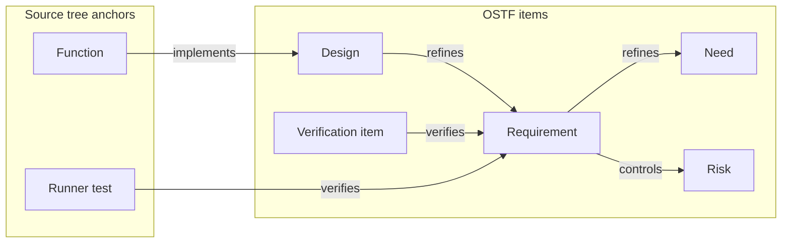

<!-- SPDX-License-Identifier: CC-BY-4.0 -->
# OSTF: Open Software Traceability Format

OSTF gives tools a shared way to answer three questions about a source tree: why does this code exist, which tests verify a requirement, and which links need another review? It records requirements and their links to code and tests in plain text files. Tools may store and serve the same graph in a database; OSTF specifies the files they exchange.

**Status:** public working draft, document revision 0.11, wire version `ostf: "0.2"`, conformance suite 0.2.0. This is a review draft. It is not OSTF 1.0, a certification program or a claim of full Core conformance.

## What it looks like

A small repository can declare its items and links in `trace.yaml`:

```yaml
ostf: "0.2"
items:
  - id: R-ADD
    text: Add two values.
    code: [math.go#Add]
    tests: [math_test.go#TestAdd]
```

`math.go#Add` names a Go function that implements `R-ADD`; `math_test.go#TestAdd` names a test that verifies it. Paths are relative to the source tree. A separate `trace.lock` records the fingerprints present when each link was rechecked. A matching stamp means those inputs have not changed under the draft's fingerprint rules. It does not establish that the test passed or the code is correct.

**What is the key?** `R-ADD` is an assigned, stable item ID within the repository's OSTF graph. It is not a function hash or a Git commit. The code and test anchors name symbols; a link is identified by its source anchor, relationship type, target ID and any link attributes. `trace.lock` stores content-derived fingerprints for freshness. A Git commit can select the source-tree view being checked, but Core does not store one as the item key. See [identity and source revisions](draft/core.md#identity-and-source-revisions).

A pull request may touch many files and many requirements. An OSTF item is the requirement, not a source line. A Git-aware tool can map changed lines in a recorded diff to their enclosing code or test anchors, then follow all links to items. Line positions belong to that diff; links use paths and symbols. The [real PR mapping example](examples/pr-impact.md) also shows how an unlinked helper change remains visible for dependency analysis and review.

The [minimal example](examples/minimal/README.md) includes real Go source and a valid lock file. The [payment retry scenario](examples/payment-retry/README.md) shows a coding agent's change in a more realistic service with a requirement, implementing method, regression test and two valid lock stamps. Larger repositories can split items into included files, and tools can declare links with `@req` comments in code. Start with an example and [scope](scope.md) to evaluate the format; use the Core draft and conformance suite when implementing it.

Core 0.2 also permits labeled `logs` references and `otel` trace/span IDs on an item. These identify places to inspect, not executed evidence or a passing test. The payment retry example uses explicitly synthetic observability references to show the shape. The [Core rule](draft/core.md#observability-references) defines the fields.

The informative [change-impact workflow](examples/change-impact.md) tests a limit of those stamps: a constructor can change while the linked method and test do not. It maps what Core supplies, what a dependency analyzer and CI supply, and which external-item and evidence-reference contracts remain proposals.

## How the entities connect

This illustrative graph uses the default profile. Each arrow points from a detail to the purpose it serves:



An item's `code` or `tests` field declares the link in YAML, but the relationship points from the source anchor to the item. `trace.lock` records endpoint fingerprints for stamped links; an Analyzer compares them with the selected source tree to report `valid`, `suspect`, `unstamped` or `broken`. The [Core draft](draft/core.md#relationships-and-identities-in-code) defines the link rules.

## Read the draft

| Document | Purpose |
| --- | --- |
| [Minimal example](examples/minimal/README.md) | A small source tree with two valid links |
| [Payment retry scenario](examples/payment-retry/README.md) | A runnable agentic change with requirement, implementation, test and lock stamps |
| [PR impact mapping](examples/pr-impact.md) | A real 11-file Git change mapped from individual lines through anchors to OSTF items |
| [Change-impact workflow](examples/change-impact.md) | Informative PR and helper-change scenario with current and proposed capability boundaries |
| [Scope](scope.md) | Core, optional modules, deferred extensions and tool boundaries |
| [Draft 0.3 specification](draft/0.3/ostf.md) | From-scratch simplified contract, candidate text for 1.0, with [schemas](draft/0.3/schema/), [lock grammar](draft/0.3/trace-lock.abnf), a [runnable example](draft/0.3/example/README.md), [fixtures](draft/0.3/fixtures/README.md) and an [agent-readiness plan](draft/0.3/plan-agent-readiness.md) |
| [Draft refactoring plan](draft/refactor-plan.md) | Superseded by the draft 0.3 specification; kept as the record of the agent-context platform direction that was considered and not taken |
| [Core contract](draft/core.md) | Versioned draft rules, deferred proposals and release gates with stable `OSTF-` IDs |
| [Go language annex](draft/go.md) and [Go runner annex](draft/go-tests.md) | Symbol, token and test identities |
| [Schemas](schema/) and [lock grammar](draft/trace-lock.ebnf) | Structural entry points and exact lock syntax |
| [Conformance suite](conformance/README.md) | Fixed vectors, a standalone Python prototype and declared limits |
| [Support map](draft/support.md) | Implemented, proposed and unqualified behavior |
| [External-item](draft/external.md) and [evidence-reference](draft/evidence.md) proposals | Interoperability questions to settle before optional extension claims |
| [White paper](white-paper.md) | Rationale and invitation to review |

The schemas use the `https://ostf.dev/draft/0.2/` identifier namespace. Validation resolves schema references from this repository; the namespace does not require a network fetch. The format's first implementation is zztrace, but its commands, permissions and internal storage are outside OSTF.

## Run the standalone draft checks

With Python 3.10 or newer and Go 1.27.2:

```sh
python3 conformance/run.py
go test ./...
(cd examples/minimal && go test ./...)
(cd examples/payment-retry && go test ./...)
```

The Python script creates an ignored virtual environment, installs exact hash-pinned dependencies and runs 112 non-schema cases through the independent-code prototype. The standalone Go test runs 24 structural schema fixtures with a local-only resolver; it does not import zztrace. The prototype and zztrace reference implementation share project authorship. zztrace has not yet adopted wire 0.2, and earlier agreement on common cases is not independent-party qualification. See the [suite details](conformance/README.md) before making a conformance claim.

## Participate

Review the [Core contract](draft/core.md) and try the fixtures with another implementation. Use the [contribution guide](CONTRIBUTING.md) and [issue templates](https://github.com/ostf-spec/ostf/issues/new/choose) for feedback; [draft governance](GOVERNANCE.md) explains how changes are decided. The draft remains 0.x until the [independent implementation and two-organization adoption gates](scope.md#versioning) are met. `ostf.dev` is reserved for the standard; this repository is the draft's public home. A preliminary trademark search remains separate work; publication is not a claim of name clearance.

For a vulnerability, use the [private security reporting path](SECURITY.md). Community participation follows the [Code of Conduct](CODE_OF_CONDUCT.md).

## License

Specification prose is [CC BY 4.0](LICENSE-CC-BY-4.0.txt). Schemas, grammar, fixtures and executable tools are [Apache 2.0](LICENSE-APACHE-2.0.txt). The [file-level license map](LICENSE.md) gives the exact split. Publication does not imply trademark registration or standards-body endorsement.
